# ERD (Mermaid)

```mermaid
erDiagram
    HOLDINGS ||--o{ LEGAL_ENTITIES : owns
    LEGAL_ENTITIES ||--o{ BRANCHES : has
    LEGAL_ENTITIES ||--o{ ENTITY_OWNERSHIPS : parent
    BRANCHES ||--o{ WAREHOUSES : has
    BRANCHES ||--o{ LOCATIONS : has
    LEGAL_ENTITIES ||--o{ FISCAL_YEARS : has
    FISCAL_YEARS ||--o{ FISCAL_PERIODS : has
    USERS }o--o{ ROLES : has
    ROLES }o--o{ PERMISSIONS : has
    USERS ||--o{ USER_SCOPES : scopes
    USERS ||--o{ AUDIT_LOGS : acts
    CUSTOMERS ||--o{ SALES_ORDERS : places
    SALES_ORDERS ||--o{ SALES_ORDER_LINES : has
    SALES_ORDERS ||--o{ INVOICES : billed
    INVOICES ||--o{ INVOICE_LINES : has
    INVOICES ||--o{ SALES_PAYMENTS : paid
    WAREHOUSES ||--o{ STOCK_LEDGERS : records
    WAREHOUSES ||--o{ STOCK_BALANCES : balances
    PRODUCTS ||--o{ STOCK_LEDGERS : moves
    PURCHASE_REQUISITIONS ||--o{ PURCHASE_ORDERS : sources
    PURCHASE_ORDERS ||--o{ PURCHASE_ORDER_LINES : has
    PURCHASE_ORDERS ||--o{ GOODS_RECEIPTS : received
    PURCHASE_ORDERS ||--o{ VENDOR_INVOICES : billed
    COAS ||--o{ JOURNAL_LINES : posts
    JOURNALS ||--o{ JOURNAL_LINES : has
    EMPLOYEES ||--o{ PAYROLL_LINES : earns
    PAYROLLS ||--o{ PAYROLL_LINES : has
    PET_OWNERS ||--o{ PETS : owns
    PETS ||--o{ VET_APPOINTMENTS : visits
    PETS ||--o{ GROOMING_ORDERS : grooms
    PETS ||--o{ BOARDING_RESERVATIONS : boards
    BOARDING_ROOMS ||--o{ BOARDING_RESERVATIONS : hosts
    TRANSPORT_ORDERS ||--o{ TRIPS : trips
    DESIGNS ||--o{ DESIGN_VERSIONS : versions
    PRODUCTS ||--o{ BOMS : has
    BOMS ||--o{ WORK_ORDERS : locked
    THRIFT_LOTS ||--o{ THRIFT_ITEMS : contains
    THRIFT_ITEMS ||--o{ LIVE_ORDERS : sold
    STUDIO_PROJECTS ||--o{ STUDIO_DELIVERABLES : delivers
    RENTAL_CATALOGS ||--o{ RENTAL_UNITS : has
    RENTAL_UNITS ||--o{ RENTAL_RESERVATIONS : booked
    APPROVALS ||--o{ APPROVAL_HISTORIES : tracks
```

Relasi lintas modul: sales↔inventory (reservasi/issue), purchasing↔inventory (GRN), sales/purchasing↔finance (posting piutang/utang, kas), HR→finance (mapping jurnal payroll: pending), semua→governance (approvals, audit).
